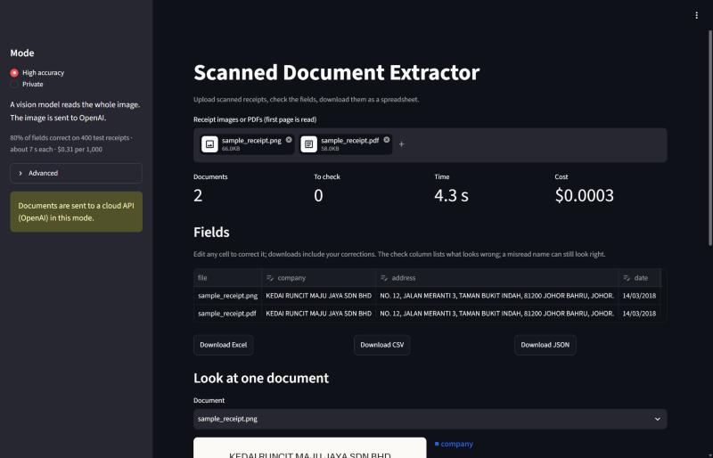
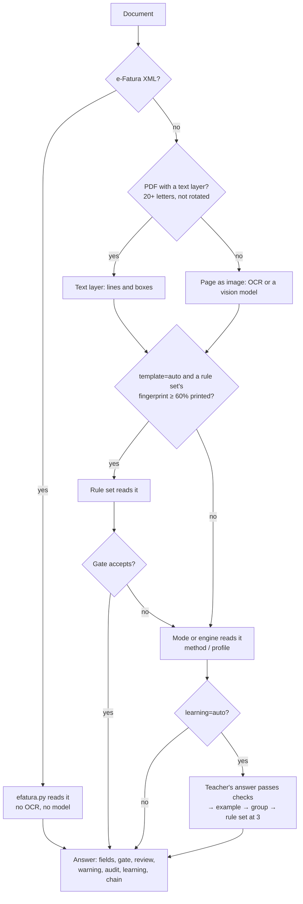

# Scanned Document Extractor

Extracts the company, address, date and total from scanned receipts, and
measures how well each approach works: classic OCR with rules, a CNN OCR, a
cloud vision model and local models that keep the document on the machine.



The receipt in the screenshot is synthetic ([docs/make_sample_receipt.py](docs/make_sample_receipt.py));
dataset images are not part of this repository.

## Use it

```bash
cp .env.example .env              # add OPENAI_API_KEY for the high-accuracy mode
docker compose up --build -d      # UI on http://localhost:8501, API on :8000
```

On first opening, the UI asks how the private mode's local model should run
and downloads it (about 2 GB, once) into the Ollama server. Until then the
private mode runs OCR and rules (E2). See [Private mode on a GPU](#private-mode-on-a-gpu).

1. Pick a mode. **High accuracy** sends the image to OpenAI (0.801 field accuracy,
   $0.51 per 1,000 receipts, line items included). **Private** runs on the server and nothing leaves it
   (free): a local vision model, E5 (0.825, about 21 s per receipt on the GPU).
   While no Ollama server is reachable it runs OCR and rules, E2 (0.631, 3.6 s),
   and says so. Without an OpenAI key only the private mode is offered.
2. Upload one or more receipt images, PDFs (first page is read, 10 MB each) or
   e-Fatura XML files (see [Digital invoices](#digital-invoices-e-fatura-and-text-pdfs)).
   The button shows the estimated cost before anything is sent.
3. Check the table. The *check* column flags fields that were not found, dates
   that are not dates and totals that are not amounts; edit any cell to correct it.
4. A second table lists every purchased item with its amount
   (experimental, see [Line items](#line-items-cord)); a receipt whose items,
   subtotal, tax and total do not add up says why in *check*.
5. Download the tables, with your corrections, as Excel (line items on a second
   sheet), CSV or JSON. Rows to check are highlighted in the Excel file.
6. Pick a document to see it next to its fields and items; with OCR engines, the
   lines each field came from are outlined in the field's colour.

The modes are defined in [profiles.yaml](profiles.yaml); the numbers next to them
are read from the evaluation reports. Under *Advanced* an engine (e2 ... e5) can be
chosen directly, and the providers not built yet are listed as planned. E1, the
Tesseract baseline, is left out of the UI (0.464 against E2's 0.631, both free
and local); the API and the reports keep it for comparison.

## Rule sets for documents of one format

In the UI, E2 reads with a rule set: choosing it (*Advanced* → *Choose the
engine myself* → e2) asks first for a saved rule set or for a new one to be
taught; documents are added after that. A rule set is for a format that comes
in again and again (one supplier's invoices). Teaching one:

1. Choose the document type: *receipt*, *invoice* (issuer, tax number, invoice
   number, date, subtotal, tax, total), or one you define with your own fields,
   each text, date or amount and optionally "may be missing".
2. Give the rule set a name and upload three documents of that format.
3. The OCR numbers every line on each example; for each field, pick its line(s)
   from a list. The value is taken from the line (the date or amount in it, or
   the text after its label) and can be corrected. From the second example on,
   the lines come picked already; you only check. On receipts E2 picks the
   first example's lines too.

The code learns where each value is printed: no model, no cost, nothing leaves
the machine. The new rule set is then chosen for E2: each document takes a few
seconds, and those it does not fit go to E5 (reading the same document type)
and are marked "rule set did not fit". The *Rule sets* page lists the saved
ones and deletes them. When the examples
disagree, the page says which example to replace or which lines to check.
Amounts with a decimal comma ("1.250,00 TL") are read as such.

On the 13 SROIE stores it learned (test split), the rule set accepted 85% of
the stores' other receipts, with 0.959 of their fields right. With E5 reading
the rest, 0.935 against 0.879 for E5 alone, at 5.5 s per receipt instead of 21 s.
It never accepted a receipt of another store
([reports/templates.md](reports/templates.md)).

A rule set reads one layout. For documents in many layouts, use E3 or, to keep
them local, E5. Rule sets and the document types users define are saved as YAML
in `templates/` (in Docker, on a volume); they are the user's data and stay out
of git. Invoice fields are not measured: there is no labelled invoice set yet.

## Rule sets without a user: chosen and learned automatically

For an agent or a batch (n8n, LangGraph), nobody picks a rule set or teaches
one. Two parameters of `/extract` do it instead; both are off by default, so
nothing changes unless they are asked for.

**`template=auto`: the rule set is chosen by the document.** Every rule set
keeps its fingerprint, the lines all its examples printed alike. The document
is read once (OCR, or a PDF's text layer) and given to the rule set whose
fingerprint it prints the largest share of, if that share is at least 60%;
otherwise it is of no known format and the chosen mode reads it. The answer
says which format was found (`format`).

**`learning=auto`: rule sets are learned from a model's answers.**

1. A document of no known format is read by the chosen mode's model, the
   *teacher*: E5 (private) or E3 (high accuracy). E2's general rules never teach.
2. Its answer becomes an example when every field the document type requires
   is found and well formed and, where the type has a subtotal, a tax and a
   total, they add up (within 0.01).
3. Examples are grouped by format: two documents are of one format when at
   least 30% of the shorter one's lines with letters are printed alike on both.
4. At three examples of one format its rule set is learned, as from a user's
   examples, and saved as *automatic*. From then on that format is read by
   the rule set: no model, a few seconds.
5. **Probation:** the first 5 documents a new rule set accepts are read by the
   teacher too. At the first disagreement the rule set is removed and the
   teacher's answer is returned, with a warning.
6. **Audit:** after probation, 2% of what an automatic rule set accepts comes
   back with `audit: true`, for a person to check.

The answer says what happened (`learning`): the document was kept as example
2 of 3, a rule set was learned, a probation check agreed, or the answer was not
kept and why. In the UI: *Advanced* → *Learn rule sets from my documents
automatically*, with the document type. The *Rule sets* page marks automatic
rule sets and their probation, and lists the formats waiting for examples
(which can be forgotten).

**What it was measured to do** (SROIE dev, 226 receipts, as a stream with E5
as the teacher; made-up invoices; [reports/auto_rule_sets.md](reports/auto_rule_sets.md)):

- Choosing: every one of 52 receipts of a store with a rule set got its own;
  6 of 141 receipts of other stores were matched to a rule set (branches of one
  chain, laid out alike), and its gate rejected all 6, so none was misread.
- Learning: 11 rule sets learned, accuracy the same as E5 alone (0.816), no
  receipt of another store accepted. SROIE has few receipts per store, so most
  rule-set reads were still on probation: E5 was saved on 2 receipts only. The
  gain comes with formats that repeat many times, which SROIE does not have.
- The teacher limits it. E5 read the subtotal wrong on 3 of 4 made-up invoices
  (the sum check refused them) and dropped a digit of every invoice number; the
  one rule set removed on probation on SROIE was right, and E5 wrong. With E3
  as the teacher, all 4 invoices were read right, the rule set was learned at
  the third and read the fourth right in 2.6 s.

So: use E3 as the teacher where documents may leave the machine for the first
few of each format; with E5, expect fewer rule sets, and the ones it learns
are only as right as E5.

## Digital invoices: e-Fatura and text PDFs

Not every document is a scan. Two kinds are read without OCR:

- **e-Fatura XML** (UBL-TR, the format of Turkey's e-Fatura and e-Arşiv). The
  issuer, tax number (VKN or TCKN), invoice number, date, amounts and every
  line come from their tags, whatever mode is chosen, in a few milliseconds.
  The ETTN, currency, scenario, invoice type and buyer come back in `meta`.
  The invoice's own amounts are checked against each other; one that does not
  add up is marked for a check. The XML is parsed with defusedxml, so a file
  that declares entities is refused.
- **PDFs with a text layer** (made by software rather than scanned). Where an
  engine would run OCR (E2, rule sets, E4, and the lines to pick from when
  teaching), the PDF's own text and positions are used instead: no misread
  letters, and about 1 ms instead of seconds. A page with too little text, or
  rotated, is a scan and goes to OCR as before. `pdf_text=off` always runs OCR.
  E3 and E5 read the image either way.

The table's *engine* column says what a document was read from: "e-Fatura
XML", "e2 (PDF text)", "rule set: … (PDF text)". Details and the check on
made-up invoices: [reports/digital_documents.md](reports/digital_documents.md).

## Private mode on a GPU

The local model runs wherever the Ollama server runs. `docker compose up` starts
one on the CPU: nothing to install, about 25 to 35 s per receipt on a laptop.
**The GPU is used only when Ollama runs where it can reach the GPU:**

- **NVIDIA GPU:** needs a recent NVIDIA driver with CUDA (`nvidia-smi` should
  list the card); on Linux also the NVIDIA Container Toolkit. Then
  `docker compose -f docker-compose.yml -f docker-compose.gpu.yml up -d`.
- **Intel or AMD GPU:** Docker cannot use these. Install Ollama on the host
  (ollama.com); for an Intel integrated GPU set `OLLAMA_IGPU_ENABLE=1` and
  restart Ollama. Put `OLLAMA_HOST=http://host.docker.internal:11434` in `.env`
  and run `docker compose up -d`.

How much faster: on the development laptop's Intel Arc 130T integrated GPU, 12 s
per receipt against 33 s on its CPU, about 2.8 times (21 s when it also reads the
line items). A dedicated NVIDIA card should be faster still; not measured. The
UI's sidebar says whether the model ran on the GPU or the CPU.

## Results (400 held-out SROIE receipts)

| Pipeline | Field accuracy | Ignoring spacing | CER | s/receipt (CPU) | USD per 1,000 | Leaves the machine |
|---|---|---|---|---|---|---|
| E1 Tesseract + rules (baseline) | 0.464 | 0.498 | 0.465 | 1.34 | 0 | no |
| E2 RapidOCR (PP-OCRv6) + general rules | 0.631 | 0.686 | 0.364 | 3.57 | 0 | no |
| E3 OpenAI gpt-6-luna, image to JSON | 0.801 | 0.863 | - | 11.7 | 0.51 | yes |
| E4 RapidOCR + local LLM (qwen3.5:4b) | 0.744 | 0.827 | 0.364 | 10.3 (iGPU) | 0 | no |
| E5 local vision model (qwen3-vl:2b-instruct) | **0.825** | **0.880** | - | 21.0 (iGPU) | 0 | no |

E1 and E2 are measured here with the general rules written for receipts. In the
UI, E2 reads with a rule set taught from the user's examples (see above); the
private mode, until its local model is set up, still runs E2's general rules.

Field accuracy is the share of fields (company, address, date, total) that match
the label exactly after normalization (case, spaces, date format, amount format).
"Ignoring spacing" also accepts a value whose only difference from the label is
spacing or punctuation, because the labels themselves write the same address
both ways. Per field, per error kind: [evaluation/results/comparison.md](evaluation/results/comparison.md).

E4 and E5 were measured with Ollama for Windows on the laptop's Intel Arc 130T
iGPU (Vulkan, `OLLAMA_IGPU_ENABLE=1`); on its CPU they take about 2.8 times as
long. E5 also reads the line items in the same call, which its time includes.
See [docs/local-runs.md](docs/local-runs.md).

Measured on an Intel Core Ultra 5 226V; E1 to E3 on the CPU only. OpenAI prices as published on
2026-10-31. E3 also reads the line items since 2026-11-19 (fields only it was 0.797,
7.2 s and $0.31); its time includes retries of OpenAI server errors during that run.

## What the numbers say

- **A better OCR is the cheapest gain.** Swapping Tesseract for RapidOCR, with the
  same rules, takes accuracy from 0.464 to 0.631 and date errors from 102 to 16.
- **Rules cannot read layout.** Given the dataset's own error-free transcripts, the
  same rules reach only 0.704: the company and address need an understanding of
  the receipt that a model brings (E3: 0.801, E5: 0.825).
- **Totals and dates are solved; names and addresses are not.** E3 gets the total
  wrong on 7 of 400 receipts and the date on 8, the company on 96 and the address
  on 208 (83 of those only in spacing).
- **The cloud model can invent text.** Where the print is faded it once wrote a
  plausible but wrong company name. Low-quality scans should go to a human check.

Details: [evaluation/results/error_analysis.md](evaluation/results/error_analysis.md).

## How it works

### What happens to a document (`POST /extract`)



1. **Is OCR needed?** Decided from the bytes, before any engine runs.

   | Document | What reads it | `text_source` |
   |---|---|---|
   | e-Fatura XML | [extractor/efatura.py](extractor/efatura.py), exact values; nothing else runs | `xml` |
   | PDF with a text layer (`pdf_text=auto`) | [extractor/ocr/pdf_text.py](extractor/ocr/pdf_text.py): lines and their boxes, no misread letters | `pdf` |
   | Scan, photo, or `pdf_text=off` | OCR, or a vision model reading the image | `ocr` |

2. **Who reads it?** The first of these that applies:
   - `template=auto`: the lines are read once and matched against every rule
     set's fingerprint; a document printing at least 60% of a rule set's fixed
     lines is read by it. If its gate rejects the read, the teacher (E3 or E5) reads it.
   - `template=<name>`: that rule set.
   - `method=e1 … e5`: that engine.
   - `profile`: `accurate` runs E3, `private` runs E5 (E2 while Ollama is
     unreachable); without either, the first available mode in [profiles.yaml](profiles.yaml).
3. **Learning (`learning=auto`).** A teacher answer with every required field
   found and well formed, and subtotal + tax = total, becomes an example. Examples
   are grouped by format (likeness ≥ 0.3); the third teaches an automatic rule
   set. Its first 5 reads are checked by the teacher (removed at the first
   disagreement), then 2% come back with `audit: true`.
4. **The answer** carries what a flow needs to decide: `gate.accepted` and
   `reasons`, `review` (fields a person should check), `warning`, `audit`,
   `learning`, `format` and `chain` (every engine that ran, with time, cost and
   its gate decision).

### Engines

| Engine | What it does | Where it runs | In the UI |
|---|---|---|---|
| E1 | Tesseract OCR, general rules | Local | Hidden; kept as the baseline |
| E2 | RapidOCR, general rules or a user's rule set | Local, fast, free | Needs a rule set |
| E3 | OpenAI vision model reads the image | Cloud, paid, most accurate | *High accuracy* |
| E4 | RapidOCR text read by a local LLM (qwen3.5:4b) | Local (Ollama) | Advanced |
| E5 | Local vision model (qwen3-vl:2b) reads the image | Local (Ollama), slow | *Private* |

### How it talks to people and other systems

- **UI** ([ui/app.py](ui/app.py), Streamlit): upload, pick a mode, check and
  correct the table, see the fields outlined on the image, download. The *Rule
  sets* page teaches a rule set from three examples and lists the automatic
  ones and the formats still waiting.
- **API** ([api.py](api.py), FastAPI): `/extract`, `/ocr`, `/templates`,
  `/profiles`, `/methods`, `/doctypes`, `/local-model`, `/health`. See [API](#api).
- **n8n or an agent:** calls `/extract` with `learning=auto` and acts on
  `gate.accepted` and `audit`; no person gives values. See [From n8n or an agent](#from-n8n-or-an-agent).

### Building blocks

- **Document types** ([extractor/doctypes](extractor/doctypes)): the fields to
  extract, their type (text, date, amount) and a description. The model prompts
  and JSON schemas are built from this file, so a new document type is a new
  YAML file, not new code.
- **Engines** ([extractor/engines](extractor/engines)): one YAML file per
  pipeline (OCR engine, field extractor, model, prices) with its measured results.
- **Modes** ([profiles.yaml](profiles.yaml)): what the user picks; each mode runs
  one engine.
- **Evaluation** ([evaluation](evaluation)): how the numbers were measured. Loads
  the dataset, runs an engine on it, reports field accuracy, CER, speed, tokens
  and cost per receipt; runs resume from a checkpoint if they stop. The product
  does not depend on it, and it is left out of the Docker images.

### Files

| Path | What it does |
|---|---|
| [api.py](api.py) | The FastAPI service: every endpoint and the flow above |
| [catalogue.py](catalogue.py) | Which modes and engines can run on this machine (OpenAI key, Ollama) |
| [local_model.py](local_model.py) | Checks the Ollama model and downloads it |
| [profiles.yaml](profiles.yaml) | The modes users pick, and their fallback engine |
| `Dockerfile`, `Dockerfile.ui`, `docker-compose*.yml` | API, UI and Ollama containers; a GPU variant |
| **extractor/** | |
| [pipeline.py](extractor/pipeline.py) | Runs an engine's steps: preprocessing, OCR (or given text), fields, line items |
| [schema.py](extractor/schema.py), [doctypes/](extractor/doctypes) | Document types and how values are normalized |
| [engines/](extractor/engines) | E1–E5 settings and measured results |
| [efatura.py](extractor/efatura.py) | e-Fatura UBL-TR XML reader |
| [amounts.py](extractor/amounts.py) | Amounts as printed ("1.250,00", "1,250.00") to numbers |
| [gate.py](extractor/gate.py) | Accept or reject: line items adding up, or required fields and sums |
| [review.py](extractor/review.py) | Flags the fields a person should check |
| [locate.py](extractor/locate.py) | Finds the OCR lines a value came from, to outline them |
| **extractor/ocr/** | `base.py` (the `OcrLine`), `tesseract.py` (E1), `rapid.py` (E2, E4), `pdf_text.py` (a PDF's text layer) |
| **extractor/fields/** | |
| [rules.py](extractor/fields/rules.py), [line_items.py](extractor/fields/line_items.py) | General rules for fields and for line items and totals |
| [template.py](extractor/fields/template.py) | Reading with a rule set |
| `openai_vision.py`, `local_llm.py`, `local_vision.py` | E3, E4, E5 model calls |
| `prompt.py`, `model_items.py`, `base.py` | Prompt and JSON schema from a document type; models' line items; the shared `Extraction` |
| **extractor/templates/** | |
| [learn.py](extractor/templates/learn.py), [read.py](extractor/templates/read.py), [values.py](extractor/templates/values.py) | Learning a rule set from examples without a model; reading with it; finding values, shared by both |
| [store.py](extractor/templates/store.py) | Rule sets as YAML in `templates/` or `TEMPLATES_DIR`, never in git |
| [choose.py](extractor/templates/choose.py) | Picks a rule set by fingerprint |
| [auto.py](extractor/templates/auto.py) | Learning without a user: groups, waiting formats, probation, audit |
| **ui/** | `app.py` (Streamlit UI), `export.py` (Excel, CSV, JSON and the notes beside each document) |
| **evaluation/** | Loading SROIE and CORD, running engines, scoring, the chain, rule-set and learning measurements; results in `evaluation/results/` |
| `reports/`, `docs/`, `scripts/`, `tests/` | Experiment reports, roadmap, dataset downloads, unit tests |

## Reproduce the measurements

```bash
bash scripts/download_sroie.sh              # SROIE with corrected labels, into data/
cp .env.example .env                        # add OPENAI_API_KEY for e3
docker compose --profile test run --rm test python -m evaluation.run --config e2
docker compose --profile test run --rm test python -m evaluation.compare
python -m evaluation.auto_eval --split dev --cache    # E2's OCR and E5 on dev (about 90 min)
python -m evaluation.auto_eval --split dev --choose   # choosing rule sets by fingerprint
python -m evaluation.auto_eval --split dev            # learning without a user, as a stream
docker compose --profile test run --rm test # unit tests
```

## API

```
GET  /profiles                 modes, whether each can run here, measured accuracy and cost
GET  /methods                  every engine (e1 ... e5) with the same details
POST /extract  file            image, PDF or e-Fatura XML; optional profile=accurate|private
               [profile|method]  or method=e1...e5 (default: the default mode)
               [template]        or template=<rule set>: read with it, E5 for what it cannot
               [template=auto]   the rule set chosen by the document's fingerprint (format)
               [learning]        auto: learn rule sets from the teacher's answers (learning,
                                 audit); implies template=auto; default off
               [doctype]         the document type engines read (receipt, invoice, a user's)
               [pdf_text]        auto (default): a PDF's text layer in place of OCR; off: OCR
               an e-Fatura XML is read from its tags whatever was chosen (method
               "efatura_xml", its ETTN, currency, type and buyer in meta);
               text_source says where the lines came from: xml, pdf, ocr, or null
               -> fields, normalized fields, fields to check, OCR lines and boxes,
                  the lines behind each field, line items (e2, e5; null otherwise),
                  seconds, tokens, USD, page count, the engines tried (chain),
                  and with a rule set a warning when it did not fit;
                  gate: {accepted, reasons}, the decision a caller acts on
GET    /doctypes               document types: the project's and the users'
POST   /doctypes               a new document type: name, fields (name, type, optional)
POST   /ocr       file         the numbered OCR lines and boxes to pick fields from
                                (a text PDF's own lines; pdf_text=off for OCR)
POST   /templates/suggest      per field, the lines and value the examples so far point to
POST   /templates/value        the value in picked lines, as learning reads it
POST   /templates/learn        name, doctype, 3-6 examples (lines, picked lines, values)
               -> "saved", or "needs_examples" with the fields that disagree and
                  which example does not fit the others
GET    /templates              saved rule sets (automatic ones with their probation),
                                formats waiting for examples, whether E5 is there
DELETE /templates/pending/{group}   forget a format waiting for examples
POST   /templates  name, files, values   the same from files, receipts only
DELETE /templates/{name}
```

`line_items` holds the items (name, quantity, unit price, amount), the subtotal,
tax, service, discount and total, and `needs_review` with the reasons. Amounts are
plain decimal strings ("43636", "9999.99"). `/methods` and `/profiles` say which
engines and modes return line items.

`gate` (with line items; null otherwise) says whether the result passed every
check and can be used without a look (`accepted`), and if not, why (`reasons`:
field notes, line-item reasons, an item that looks like an add-on). Documents it
does not accept are the ones to send on to a model or a person. On CORD it
accepts about half of the receipts read end to end, and about 1 in 40 of those is
still wrong: [reports/cord_gate.md](reports/cord_gate.md).

An engine that cannot run on the server (no OpenAI key, no Ollama) is answered
with 503 and the reason.

### From n8n or an agent

One HTTP call per document: `POST /extract` (multipart, the file as `file`).
For a flow that should need no one:

- send `learning=auto` (rule sets chosen and learned, see above) and
  `doctype=invoice` (or `receipt`, or a type of your own); an e-Fatura XML is
  read from its tags whatever is sent;
- act on `gate.accepted`: true means every check passed, write the fields on;
  false, send the document and `gate.reasons` to a person. Every answer has a
  decision: with line items they must add up, without them (invoices read by
  E3 or E5) the required fields must be found and well formed, and subtotal,
  tax and total must add up. A misread name can still pass;
- also send to a person what comes back with `audit: true`, and read
  `warning` when it is set;
- allow 120 s per request (E5 takes 20 to 30 s, twice that while a new rule
  set is on probation). Requests are served side by side: a document being
  read does not hold up the next one or `/health`, though documents for E5
  still wait for each other in Ollama;
- run the flow on the same machine or Docker network: the API has no
  authentication yet (roadmap 19), and listens on localhost only.

## Data

[SROIE](https://rrc.cvc.uab.es/?ch=13) (ICDAR 2019) receipts with the corrected
labels from [zzzDavid/ICDAR-2019-SROIE](https://github.com/zzzDavid/ICDAR-2019-SROIE).
That folder holds the 626 labelled training receipts; the official test labels
are not in it. They are split once with a fixed seed into 400 test receipts,
used only for the reported numbers, and 226 dev receipts, used to write the
rules and the field descriptions. The 400 are not the official SROIE test set.

### Line items (CORD)

E2 also returns line items, read by rules ([extractor/fields/line_items.py](extractor/fields/line_items.py)):
every purchased item with its amount, the subtotal, tax, service, discount and
total, and a `needs_review` flag when the numbers do not add up. The receipt
document type declares them (`line_items: true`) and an engine reads them when its
YAML says how: `line_items: rules` (E2, from the OCR boxes) or `line_items: model`
(E5 and E3: the vision model is asked for the items in the same call as the fields;
its answer is parsed and reconciled like the rules'). For E2, OCR runs once: the rules get
the boxes as detected, the field rules the same boxes joined into lines as before,
so E2's field results do not change. It is measured
on [CORD v2](https://huggingface.co/datasets/naver-clova-ix/cord-v2)
(Park et al., *CORD: A Consolidated Receipt Dataset for Post-OCR Parsing*,
Document Intelligence Workshop at NeurIPS 2019; CC-BY-4.0), 1,000 Indonesian
receipts. Results and error analysis: [reports/cord_line_items.md](reports/cord_line_items.md).

On the CORD test split E3 gets 87 of 100 receipts' items fully right, E5 64 and
E2 62; E2 first and E3 for what E2's gate rejects handles 76 in 100 without a
person, for about $0.21 per 1,000 receipts:
[reports/cord_e3_line_items.md](reports/cord_e3_line_items.md).

```bash
bash scripts/download_cord.sh                                   # 2.3 GB, into data/cord/
python -m evaluation.cord_eval --mode oracle --split validation # dataset words as OCR
python -m evaluation.cord_eval --mode e2e --split validation    # RapidOCR on the image
python -m evaluation.cord_gate --mode e2e --split validation    # the review gate on those results
OLLAMA_HOST=http://localhost:11434 python -m evaluation.cord_eval --mode e5 --split validation --threads 8
python -m evaluation.cord_gate --hybrid --split validation       # E2, then E5 for what E2's gate rejects
python -m evaluation.cord_eval --mode e3 --split validation      # OpenAI; about $0.04 per 100 receipts
python -m evaluation.cord_gate --hybrid --second e3 --split validation
```

## Limitations

- Tested on printed English receipts from one country (Malaysia). Handwriting,
  multi-page documents and other document types are not measured yet.
- The highlighted boxes in the UI mark every OCR line that contains a value; when a
  subtotal equals the total, both lines are outlined.
- The *check* column only catches values that are missing or malformed. A
  well-formed but wrong value, such as a misread company name, is not flagged.
- Only the first page of a PDF is read.
- E5's and E3's line items are measured on CORD, not SROIE:
  [reports/cord_e5_line_items.md](reports/cord_e5_line_items.md),
  [reports/cord_e3_line_items.md](reports/cord_e3_line_items.md).
- Line items are measured on Indonesian receipts (CORD), not on the Malaysian
  ones the fields are measured on (SROIE has no item labels). About half of the
  CORD receipts read end to end are flagged for review. E2 and E5 return them.
- The field rules were written for Malaysian receipts; on other receipts the
  fields' total and the line items' total can disagree. Both are reported as
  read, and *check* says the total differs from the line items' total.
