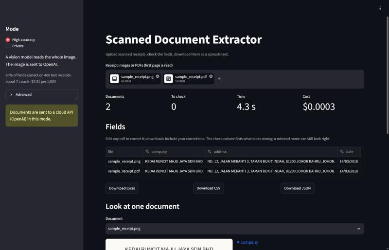

# Scanned Document Extractor

Extracts the company, address, date and total from scanned receipts, and
measures how well each approach works: classic OCR with rules, a CNN OCR, a
cloud vision model and local models that keep the document on the machine.



The receipt in the screenshot is synthetic ([docs/make_sample_receipt.py](docs/make_sample_receipt.py));
dataset images are not part of this repository.

## Use it

```bash
cp .env.example .env              # add OPENAI_API_KEY for the high-accuracy mode
docker compose up --build -d      # UI on http://localhost:8501, API on :8000
```

1. Pick a mode. **High accuracy** sends the image to OpenAI (0.797 field accuracy,
   $0.31 per 1,000 receipts). **Private** runs on the server and nothing leaves it
   (0.631, free). Without an OpenAI key only the private mode is offered.
2. Upload one or more receipt images or PDFs (first page is read, 10 MB each).
   The button shows the estimated cost before anything is sent.
3. Check the table. The *check* column flags fields that were not found, dates
   that are not dates and totals that are not amounts; edit any cell to correct it.
4. Download the table, with your corrections, as Excel, CSV or JSON. Rows to
   check are highlighted in the Excel file.
5. Pick a document to see it next to its fields; with OCR engines, the lines each
   field came from are outlined in the field's colour.

The modes are defined in [profiles.yaml](profiles.yaml); the numbers next to them
are read from the evaluation reports. Under *Advanced* any engine (e1 ... e5) can be
chosen directly, and the providers not built yet are listed as planned.

## Results (400 held-out SROIE receipts)

| Pipeline | Field accuracy | Ignoring spacing | CER | s/receipt (CPU) | USD per 1,000 | Leaves the machine |
|---|---|---|---|---|---|---|
| E1 Tesseract + rules (baseline) | 0.464 | 0.498 | 0.465 | 1.34 | 0 | no |
| E2 RapidOCR (PP-OCRv6) + rules | 0.631 | 0.686 | 0.364 | 3.57 | 0 | no |
| E3 OpenAI gpt-6-luna, image to JSON | **0.797** | **0.858** | - | 7.16 | 0.31 | yes |
| E4 RapidOCR + local LLM (qwen3.5:4b) | not measured yet | | | | 0 | no |
| E5 local vision model (qwen3-vl:2b) | not measured yet | | | | 0 | no |

Field accuracy is the share of fields (company, address, date, total) that match
the label exactly after normalization (case, spaces, date format, amount format).
"Ignoring spacing" also accepts a value whose only difference from the label is
spacing or punctuation, because the labels themselves write the same address
both ways. Per field, per error kind: [evaluation/results/comparison.md](evaluation/results/comparison.md).

E4 and E5 run their models on the CPU through Ollama and need more memory than
the 7.5 GB Docker had on the development laptop; see [docs/local-runs.md](docs/local-runs.md).

Measured on an Intel Core Ultra 5 226V, CPU only. OpenAI prices as published on
2026-10-31.

## What the numbers say

- **A better OCR is the cheapest gain.** Swapping Tesseract for RapidOCR, with the
  same rules, takes accuracy from 0.464 to 0.631 and date errors from 102 to 16.
- **Rules cannot read layout.** Given the dataset's own error-free transcripts, the
  same rules reach only 0.704: the company and address need an understanding of
  the receipt that a model brings (E3: 0.797).
- **Totals and dates are solved; names and addresses are not.** E3 gets the total
  wrong on 9 of 400 receipts and the date on 10, the company on 99 and the address
  on 206 (81 of those only in spacing).
- **The cloud model can invent text.** Where the print is faded it once wrote a
  plausible but wrong company name. Low-quality scans should go to a human check.

Details: [evaluation/results/error_analysis.md](evaluation/results/error_analysis.md).

## How it works

```
image ─► OCR (Tesseract | RapidOCR) ─► lines + boxes ─► fields (rules | local LLM)
image ─────────────────────────────────────────────────► fields (OpenAI vision | local vision model)
```

- **Document types** ([extractor/doctypes](extractor/doctypes)): the fields to
  extract, their type (text, date, amount) and a description. The model prompts
  and JSON schemas are built from this file, so a new document type is a new
  YAML file, not new code.
- **Experiments** ([evaluation/configs](evaluation/configs)): one YAML file per
  pipeline (OCR engine, field extractor, model, prices).
- **Evaluation** ([evaluation](evaluation)): field accuracy, CER, speed, tokens and
  cost per receipt; runs resume from a checkpoint if they stop.

## Run it

```bash
bash scripts/download_sroie.sh              # SROIE with corrected labels, into data/
cp .env.example .env                        # add OPENAI_API_KEY for e3
docker compose up --build -d                # API on :8000, UI on :8501
docker compose --profile test run --rm test python -m evaluation.run --config e2
docker compose --profile test run --rm test python -m evaluation.compare
docker compose --profile test run --rm test # unit tests
```

## API

```
GET  /profiles                 modes, whether each can run here, measured accuracy and cost
GET  /methods                  every engine (e1 ... e5) with the same details
POST /extract  file            image or PDF; optional profile=accurate|private
               [profile|method]  or method=e1...e5 (default: the default mode)
               -> fields, normalized fields, fields to check, OCR lines and boxes,
                  the lines behind each field, seconds, tokens, USD, page count
```

An engine that cannot run on the server (no OpenAI key, no Ollama) is answered
with 503 and the reason.

## Data

[SROIE](https://rrc.cvc.uab.es/?ch=13) (ICDAR 2019) receipts with the corrected
labels from [zzzDavid/ICDAR-2019-SROIE](https://github.com/zzzDavid/ICDAR-2019-SROIE).
That folder holds the 626 labelled training receipts; the official test labels
are not in it. They are split once with a fixed seed into 400 test receipts,
used only for the reported numbers, and 226 dev receipts, used to write the
rules and the field descriptions. The 400 are not the official SROIE test set.

## Limitations

- Tested on printed English receipts from one country (Malaysia). Handwriting,
  multi-page documents and other document types are not measured yet.
- The highlighted boxes in the UI mark every OCR line that contains a value; when a
  subtotal equals the total, both lines are outlined.
- The *check* column only catches values that are missing or malformed. A
  well-formed but wrong value, such as a misread company name, is not flagged.
- Only the first page of a PDF is read.
- E4 and E5 are not measured yet.
